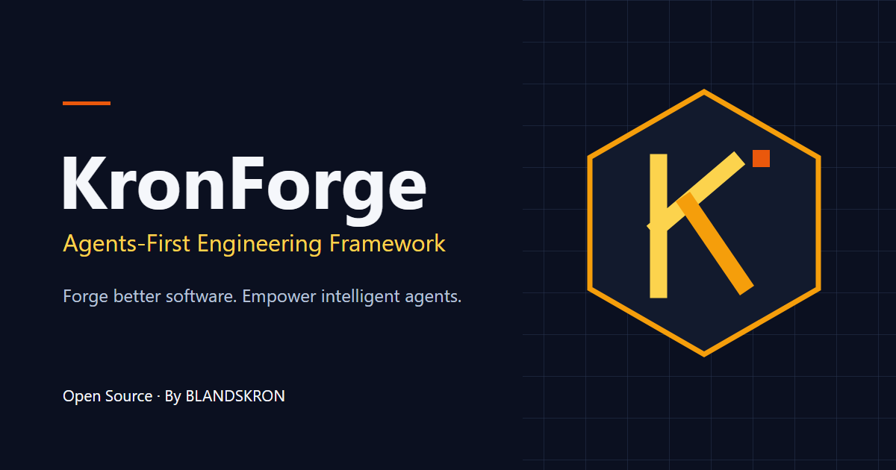
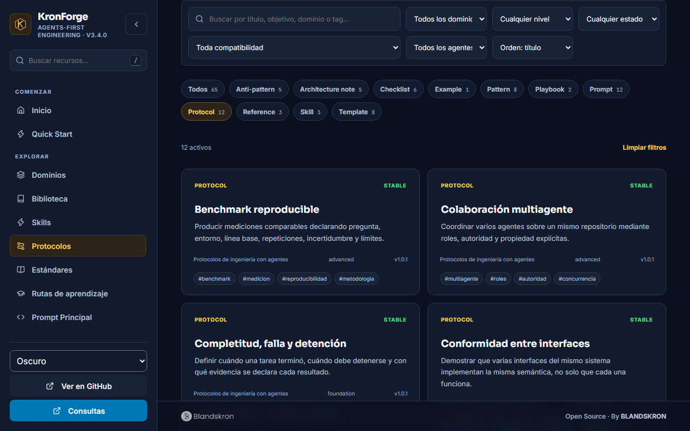
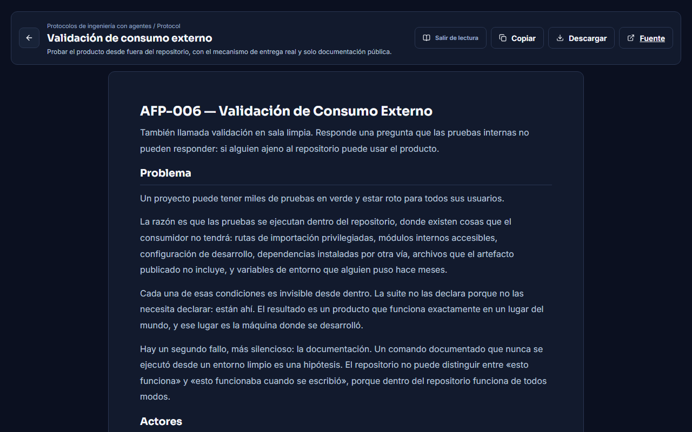

# KronForge — Agents-First Engineering Framework



**Forge better software. Empower intelligent agents.** · Open Source · By BLANDSKRON.

Anteriormente Agents First Framework. [Guía de marca](docs/BRAND_GUIDELINES.md) · [Sistema de diseño](docs/DESIGN_SYSTEM.md).

Plataforma documental abierta de AI Engineering para diseñar contexto, repositorios, agentes y software verificable mediante conocimiento reutilizable.

KronForge 3.4.0 organiza el conocimiento en capas, con catálogo machine-readable, contratos editoriales, rutas de aprendizaje, gobierno OSS y controles de calidad reproducibles. La compatibilidad se apoya en Markdown e instrucciones explícitas y es agnóstica al modelo, proveedor y stack.

El Markdown de `library/` es la fuente canónica de los activos. El [catálogo](library/catalog.json) se mantiene en paridad con sus metadatos. Las [skills distribuibles](skills/README.md), [`llms.txt`](llms.txt) y los [metadatos de aprendizaje](library/learning-guidance.json) se regeneran con `npm run build`. Las referencias declaradas se rigen por la [política de frescura](docs/SPEC_FRESHNESS.md).

El flujo operativo se mantiene simple: **Copiar -> Pegar -> Auditar -> Aprobar -> Aplicar**.

> [!TIP]
> Explora el [portal en GitHub Pages](https://blandskron.github.io/KronForge/), entra al [catálogo por dominios](library/README.md) o consulta la [arquitectura v3](docs/architecture/FRAMEWORK_ARCHITECTURE.md).

## Qué encontrarás

- un [prompt maestro](prompts/agents-first-documentation-review.prompt.md) para preparar repositorios agents-first;
- una [biblioteca por dominios](library/README.md) con activos ejecutables, de conocimiento, gobierno e integración;
- una [suite de protocolos de ingeniería](library/domains/engineering-protocols/README.md) para que personas y agentes deleguen, revisen, validen y publiquen con evidencia verificable;
- un [catálogo v3](library/catalog.json) validado por [JSON Schema](library/schema/catalog-v3.schema.json);
- relaciones entre activos, [rutas de aprendizaje](docs/LEARNING_GUIDANCE.md), [tutoriales por dominio](docs/tutorials/README.md) y [casos reproducibles](docs/cases/README.md);
- documentación operativa en [`docs/agent/`](docs/agent/) y un [registro de decisiones](docs/adr/README.md);
- gobierno OSS, controles automáticos y un portal estático sin build de producción.

No es una colección masiva de prompts, un runtime ni una metodología prescriptiva. Organiza capacidades reutilizables y deja que cada activo se adapte a la evidencia del proyecto objetivo.

## Cómo usar KronForge

### 1. Encuentra un activo para tu tarea

Abre la [biblioteca](https://blandskron.github.io/KronForge/#library) y busca por objetivo, título o etiqueta. Usa los filtros de dominio, tipo y nivel para acotar los resultados. Para una auditoría completa de un repositorio, empieza con el [prompt maestro](prompts/agents-first-documentation-review.prompt.md).



### 2. Revisa y obtén el Markdown

Abre un resultado y comprueba su propósito, entradas, salidas y límites antes de aplicarlo. **Copiar** lleva el Markdown al portapapeles. **Descargar** guarda el archivo canónico para incorporarlo a un repositorio. **Fuente** permite consultar el original. El [protocolo AFP-006](https://blandskron.github.io/KronForge/#library/engineering-protocols.external-consumption-validation) muestra el visor y sus controles.



### 3. Aplica el activo en Codex

Abre en Codex el repositorio objetivo y pega el Markdown del activo o indica la ruta del archivo descargado. Añade el objetivo, el alcance y las restricciones del proyecto. Adapta esta instrucción a tu tarea.

> Lee las reglas del repositorio y audita el alcance usando este activo. Entrega hallazgos, un plan de cambios y los controles que vas a ejecutar. Espera mi aprobación antes de aplicar el plan.

Revisa el diagnóstico y autoriza el alcance. Al finalizar, conserva el diff, los comandos ejecutados y la evidencia de sus resultados. Puedes seguir el mismo flujo con cualquier agente que lea Markdown.

### Prueba local de packs

El [prototipo de packs](docs/KRONFORGE_PACK_PREVIEW.md) permite ensayar planificación, instalación, actualización y retiro con un repositorio desechable. La [guía del kit sintético](docs/KRONFORGE_EXTERNAL_TRIAL.md) incluye la prueba en Codex y qué evidencia devolver.

## Dominios

| Dominio | Ejemplos de alcance |
|---|---|
| [IA y agentes](library/domains/ai-agent-engineering/README.md) | agentes, subagentes, memoria, RAG y evaluación |
| [Context Engineering](library/domains/context-engineering/README.md) | capas, routing, compresión y retrieval |
| [Repository Engineering](library/domains/repository-engineering/README.md) | repositorios AI-First y contexto mantenible |
| [MCP e integraciones](library/domains/mcp-integration/README.md) | tools, resources, clientes, servidores y seguridad |
| [Cadena de suministro de agentes](library/domains/agent-supply-chain/README.md) | confianza, procedencia, privilegio mínimo y revisión de skills |
| [Interoperabilidad entre agentes](library/domains/agent-interoperability/README.md) | A2A, tarjetas de agente, identidad y fronteras entre protocolos |
| [Protocolos de ingeniería](library/domains/engineering-protocols/README.md) | delegación, evidencia, revisión independiente, validación externa y publicación |
| [Hooks y workflows](library/domains/hooks-workflows/README.md) | automatización, gates, testing y notificaciones |
| [Arquitectura](library/domains/architecture/README.md) | decisiones, modularidad, DDD y estilos |
| [Desarrollo de software](library/domains/software-development/README.md) | backend, frontend, APIs y refactoring |
| [Datos](library/domains/data/README.md) | modelos, migraciones, contratos y pipelines |
| [Ingeniería de calidad](library/domains/quality-engineering/README.md) | testing, QA, code review y DoD |
| [Seguridad](library/domains/security/README.md) | AppSec, supply chain, secretos e IAM |
| [Entrega y plataforma](library/domains/delivery-platform/README.md) | CI/CD, releases, cloud y contenedores |
| [Confiabilidad y performance](library/domains/reliability-performance/README.md) | observabilidad, incidentes y rendimiento |
| [Experiencia y accesibilidad](library/domains/experience-accessibility/README.md) | UX, UI, WCAG y usabilidad |
| [Producto y gestión técnica](library/domains/product-technical-management/README.md) | discovery, RFC, planificación y riesgo |
| [Documentación y conocimiento](library/domains/documentation-knowledge/README.md) | auditoría, runbooks y documentación como código |

## Principios

- Leer antes de modificar.
- No inventar comandos, arquitectura, dependencias ni resultados.
- Ser universal por defecto y específico solo después de detectar evidencia.
- Planificar antes de cambiar y pedir aprobación para acciones sensibles.
- No exponer secretos ni relajar pruebas o seguridad para aprobar.
- Enlazar conocimiento común en vez de duplicarlo.
- Priorizar calidad y mantenibilidad sobre volumen.

## Arquitectura del repositorio

```txt
KronForge/
|-- prompts/                  # puerta de entrada ejecutable
|-- library/
|   |-- catalog.json         # proyección machine-readable v3
|   |-- schema/              # contrato JSON Schema
|   `-- domains/<domain>/    # fuentes Markdown canónicas
|-- skills/                   # proyección generada en formato Agent Skills
|-- llms.txt                  # proyección generada de descubrimiento para agentes
|-- docs/
|   |-- architecture/        # modelo por capas
|   |-- adr/                 # decisiones arquitectónicas
|   |-- audits/              # evidencia y brechas
|   `-- agent/               # operación para agentes
|-- scripts/                 # validadores sin dependencias
|-- tests/                   # pruebas unitarias del portal
|-- .github/                 # gobierno y quality gate
|-- index.html
|-- assets/
`-- pages/
```

Las siete capas de orientación, protocolo, conocimiento, ejecución, gobernanza, presentación y automatización están descritas en la [arquitectura del framework](docs/architecture/FRAMEWORK_ARCHITECTURE.md). El Markdown es la fuente canónica de los activos. El catálogo y el portal permiten descubrirlos.

## Calidad reproducible

Node.js se usa únicamente para controles de mantenimiento; el sitio publicado continúa siendo HTML, CSS y JavaScript vanilla.

```powershell
npm run quality
```

En PowerShell con política de ejecución restrictiva, el mismo control se ejecuta con `npm.cmd run quality`.

El comando valida catálogo y schema, front matter, relaciones, enlaces y anclas, seguridad documental, JavaScript, navegación de GitHub Pages, pruebas unitarias y el [AI Repository Score](docs/AI_REPOSITORY_SCORE.md). También comprueba la conformidad de las skills con el formato abierto, que su proyección no diverja de la fuente y que ninguna referencia externa lleve más de 180 días sin verificar. La misma secuencia se ejecuta en GitHub Actions.

Tras modificar una skill canónica o el catálogo, regenera las superficies:

```powershell
npm run build
```

## Contribuir y gobernar

Lee [CONTRIBUTING.md](CONTRIBUTING.md), el [contrato de activos](docs/CONTRIBUTING_ASSETS.md), la [gobernanza](GOVERNANCE.md) y el [código de conducta](CODE_OF_CONDUCT.md). Toda contribución debe:

- ubicarse en un dominio claro;
- aportar un resultado reusable;
- seguir el contrato de metadatos;
- evitar duplicidad y dependencias innecesarias de proveedor;
- actualizar índices y changelog;
- pasar las [validaciones documentales](docs/agent/TESTS.md).

La [estrategia integral](docs/AI_ENGINEERING_FRAMEWORK_STRATEGY.md), el [plan de implementación v3](docs/V3_IMPLEMENTATION_PLAN.md) y el [roadmap hasta v5](docs/ROADMAP.md) documentan el rumbo. Para soporte consulta [SUPPORT.md](SUPPORT.md); para reportes de seguridad, [SECURITY.md](SECURITY.md).

## Uso con agentes

Los agentes deben leer [AGENTS.md](AGENTS.md) antes de trabajar. La [matriz de compatibilidad](docs/AGENT_COMPATIBILITY.md) documenta el consumo de Markdown y el descubrimiento nativo según el cliente.

## Sitio estático

GitHub Pages sirve [`index.html`](index.html), [`assets/`](assets/), [`pages/`](pages/) y el Markdown canónico directamente desde la raíz. El portal ofrece búsqueda, filtros, URLs compartibles por activo, lectura Markdown, copia y descarga sin runtime ni build de producción.

## Versionado y licencia

Los activos siguen [versionado semántico y reglas de deprecación](PROMPT_VERSIONING.md). Los cambios notables se registran en [docs/CHANGELOG.md](docs/CHANGELOG.md).

Licencia MIT. Consulta [LICENSE](LICENSE).
